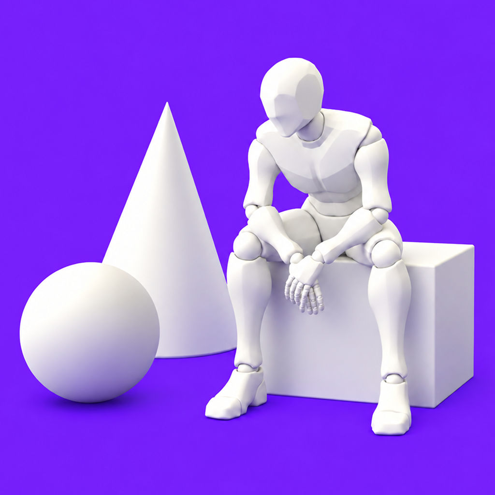
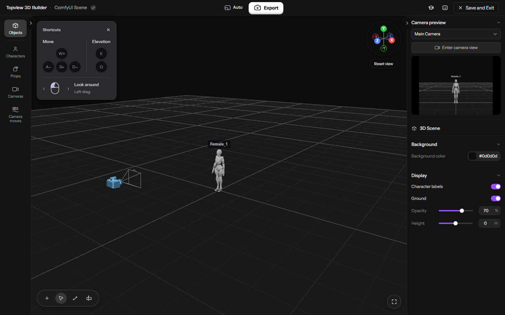

<p align="center">
  
</p>

<h1 align="center">Topview 3D Builder for ComfyUI</h1>

**English** · [简体中文](README.zh-CN.md)

Build a 3D scene, frame your shot, and export images or animated videos directly to the ComfyUI canvas.

## Installation

No frontend build, Node.js runtime or API key is required.

**Option 1 — Git (recommended)**

Open a terminal inside your `ComfyUI/custom_nodes` folder and run:

```sh
git clone https://github.com/gyx85542-dot/ComfyUI-Topview-3D-Builder.git
```

**Option 2 — Download ZIP**

Use **Code → Download ZIP** on this repository. Extract the plugin folder into `ComfyUI/custom_nodes`. Make sure `__init__.py` is directly inside the plugin folder, with no extra nested repository folder:

```text
ComfyUI/
└── custom_nodes/
    └── ComfyUI-Topview-3D-Builder/
        ├── __init__.py
        ├── backend.py
        ├── assets/
        ├── editor/
        └── web/
```

Restart ComfyUI, then refresh the browser (**Ctrl+F5** if cached files remain). Install only one copy of this plugin: if an older `Topview-3D-Builder` folder already exists, update or replace that copy instead of keeping both names installed.

## Updates

For a Git installation, open a terminal inside the installed plugin folder:

```sh
git pull
```

## Tutorial

[3D Builder: Build Scenes, Stage Action, and Move the Camera](https://www.topview.ai/academy/spatial-control#3-1-3d-builder-build-scenes-stage-action-and-move-the-camera)

## Features

- **3D scene building:** place characters and objects, adjust poses, and compose your shot.
- **Built-in assets:** 4 characters, 121 static poses and 5 primitive types.
- **Cameras and animation:** frame shots, preview camera views, and plan animation with camera movement presets and the timeline.
- **Image and video export:** choose cameras, frame ranges, resolution and aspect ratio. Download locally or export directly to the ComfyUI canvas.
- **Multilingual UI:** follows ComfyUI settings with support for 15 languages.



### Quick start

1. Add **Topview → Topview 3D Builder** from the node menu or search for **Topview 3D Builder**.
2. Click **Open 3D Builder**. Add characters or objects, adjust poses, and set up your camera.
3. Click the central **Export** button. Select **Image** or **Video**, then configure the output.
4. Click **Export to ComfyUI canvas**. After successful export and saving, the editor closes and the exported media appears as a native node.
5. To save the scene without creating a media node, click **Save and Exit**. This updates the Builder card's preview and closes the editor.
6. **Save your ComfyUI workflow** to keep the editable scene with the graph. Saving inside the editor does not save the workflow file itself.

## Development

This project is based on our other project, [Topview 3D Builder](https://github.com/topviewai/topview-3d-builder), which supports integration with any agent tool to generate animated 3D scenes.

## License

- Code: [Apache-2.0](LICENSE), [NOTICE](NOTICE).
- Bundled assets: [assets/LICENSE](assets/LICENSE), [assets/NOTICE](assets/NOTICE).
- Fonts: [Darker Grotesque OFL](licenses/OFL.txt), [Instrument Sans OFL](licenses/OFL-instrument-sans.txt).
- Frontend dependencies: [JavaScript notices](editor/main.js.LEGAL.txt), [CSS notices](editor/main.css.LEGAL.txt).

---

Support our other project, [Topview 3D Builder](https://github.com/topviewai/topview-3d-builder), for creating 3D scenes with an agent.
