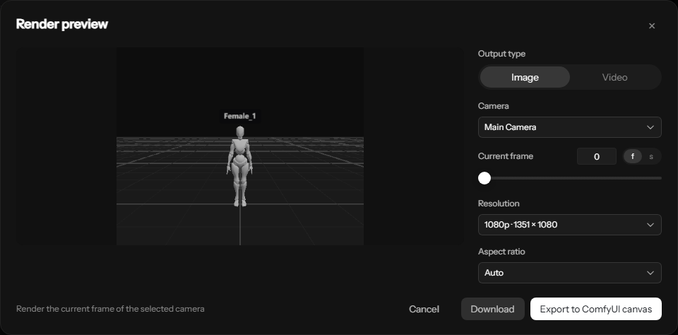
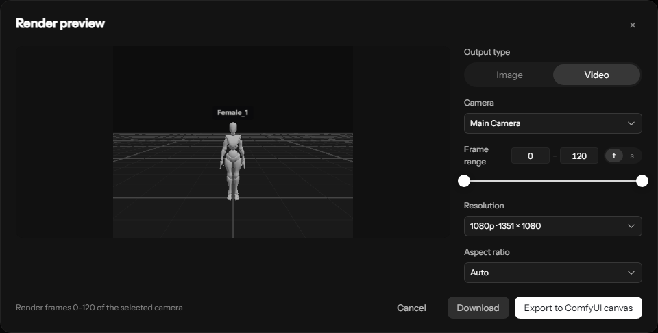

# Topview 3D Builder for ComfyUI

**Build a 3D scene, frame your shot, and export images or animated videos directly to the ComfyUI canvas.**

**在 ComfyUI 中搭建 3D 场景、调整机位，并将图片或动画视频直接导出到画布。**

[English](#english) · [简体中文](#简体中文) · [Screenshots / 界面截图](#screenshots--界面截图)

The compiled editor and built-in assets are included. No frontend build, Node.js runtime, account, API key or agent is required to use the plugin.

仓库包含已编译的编辑器和内置素材，使用时无需编译前端、安装 Node.js、注册账号、配置 API Key 或运行 Agent。

## Screenshots / 界面截图

### Scene editor / 场景编辑器


### Image export / 图片导出



### Video export / 视频导出



Screenshots show the English interface; the plugin follows your ComfyUI language setting.

截图展示英文界面；插件会跟随 ComfyUI 的语言设置。

## English

### Features

- **Interactive 3D staging:** place and transform characters and primitive objects, adjust poses, and compose your scene.
- **Bundled assets:** 4 characters, 121 static poses and 5 primitive types, available locally.
- **Camera tools:** camera preview, shot composition and camera movement presets.
- **Timeline:** edit scene animation and export a selected frame range as video.
- **Image and video export:** choose camera, frame or frame range, resolution and aspect ratio. Download locally or export directly to the ComfyUI canvas.
- **Native workflow integration:** image exports create `LoadImage` nodes; video exports create `LoadVideo` nodes for downstream processing.
- **Compact editor:** a centered floating window occupying 90% of the viewport, with a single toolbar and **Save and Exit**.
- **Scene persistence:** editable scene data is stored in the Builder node's properties and included when you save the ComfyUI workflow.
- **15 UI languages:** English, Simplified Chinese, Traditional Chinese, Japanese, Korean, French, German, Spanish, Portuguese, Russian, Arabic, Turkish, Indonesian, Malay and Vietnamese.

### Requirements

- A working ComfyUI installation with its Python dependencies installed.
- A browser with WebGL support. Video export also depends on browser codec support.
- A ComfyUI version providing the native `LoadVideo` node for video export to the canvas.

Validated locally with ComfyUI **0.22.0** and frontend **1.43.18**. Other versions have not all been tested.

### Installation

**Option 1 — Git (recommended)**

Open a terminal inside your `ComfyUI/custom_nodes` folder and run:

```sh
git clone https://github.com/gyx85542-dot/ComfyUI-Topview-3D-Builder.git
```

For Windows portable, the parent folder is typically:

```text
ComfyUI_windows_portable/ComfyUI/custom_nodes/
```

**Option 2 — Download ZIP**

Use **Code → Download ZIP** on this repository. Extract the plugin folder into `ComfyUI/custom_nodes`. Make sure `__init__.py` is directly inside the plugin folder, with no extra nested repository folder:

```text
ComfyUI/
└── custom_nodes/
    └── ComfyUI-Topview-3D-Builder/
        ├── __init__.py
        ├── backend.py
        ├── assets/
        ├── editor/
        └── web/
```

Restart ComfyUI, then refresh the browser (**Ctrl+F5** if cached files remain). Install only one copy of this plugin: if an older `Topview-3D-Builder` folder already exists, update or replace that copy instead of keeping both names installed.

### Quick start

1. Add **Topview → Topview 3D Builder** from the node menu or search for **Topview 3D Builder**.
2. Click **Open 3D Builder**. Add characters or objects, adjust poses, and set up your camera.
3. Click the central **Export** button. Select **Image** or **Video**, then configure the output.
4. Click **Export to ComfyUI canvas**. After successful export and saving, the editor closes and the exported media appears as a native node.
5. To save the scene without creating a media node, click **Save and Exit**. This updates the Builder card's preview and closes the editor.
6. **Save your ComfyUI workflow** to keep the editable scene with the graph. Saving inside the editor does not save the workflow file itself.

The Builder node has no input/output ports. Connect the exported image or video node to the rest of your workflow. You can also drag [the example workflow](examples/topview-3d-preview.json) into ComfyUI to try a two-character scene.

### Updates

For a Git installation, open a terminal inside the installed plugin folder:

```sh
git pull
```

Restart ComfyUI and refresh the browser. For a ZIP installation, replace the plugin files with the latest download after backing up any custom changes.

### Storage and troubleshooting

- Scene previews and corresponding JSON files: `ComfyUI/input/topview3d/`.
- Exported images and videos: `ComfyUI/input/topview3d/exports/`.
- After moving a workflow to another machine, open the Builder and select **Save and Exit** to regenerate a missing preview. Copy exported media separately if your workflow references it.
- If the node is missing, check the installation folder structure and ComfyUI startup logs, then restart and refresh.
- If `LoadVideo` is unavailable, update ComfyUI or use **Download** in the export dialog.
- If loading fails, use **Retry** or **Exit Without Saving**. The latter restores the Builder scene state from before opening the editor. If saving fails, the editor stays open so you can retry.

### Current scope

The bundled library contains static poses, **not character motion clips**. The empty Motions tab is hidden; camera moves and timeline animation remain available. Depth, normal and OpenPose render passes, external model import, and API-only rendering are not included. Only one Builder editor can be open at a time.

## 简体中文

### 功能介绍

- **交互式 3D 场景搭建**：放置、移动、旋转和缩放角色与基础物体，调整角色姿势与画面构图。
- **本地内置素材**：包含 4 个角色、121 个静态姿势和 5 种基础几何体。
- **机位与运镜**：支持相机预览、镜头构图与运镜预设。
- **时间轴动画**：编辑场景动画，并将指定帧范围导出为视频。
- **图片与视频导出**：选择机位、帧或帧范围、分辨率及画幅比例，可下载到本地或导出到 ComfyUI 画布。
- **原生节点衔接**：图片导出生成 `LoadImage` 节点，视频导出生成 `LoadVideo` 节点，供后续工作流使用。
- **紧凑浮窗**：编辑器居中显示，占视口的 90%；使用单行工具栏，右侧提供“保存并退出”。
- **场景保存**：可编辑场景保存在 Builder 节点属性中，随 ComfyUI 工作流一起保存。
- **15 种界面语言**：跟随 ComfyUI 语言设置，支持中英文、日语、韩语、法语、德语等。

### 运行要求

- 已正常安装并能运行的 ComfyUI，以及其 Python 依赖。
- 支持 WebGL 的浏览器；视频导出还依赖浏览器的编码能力。
- 导出视频到画布需要 ComfyUI 提供原生 `LoadVideo` 节点。

本地验证环境为 ComfyUI **0.22.0**、前端 **1.43.18**，尚未覆盖所有版本。

### 安装方法

**方法一：Git 安装（推荐）**

在 `ComfyUI/custom_nodes` 目录打开终端，执行：

```sh
git clone https://github.com/gyx85542-dot/ComfyUI-Topview-3D-Builder.git
```

Windows 便携版通常位于 `ComfyUI_windows_portable/ComfyUI/custom_nodes/`。

**方法二：下载 ZIP**

点击仓库页面的 **Code → Download ZIP**，将插件文件夹解压到 `ComfyUI/custom_nodes`。确认 `__init__.py` 直接位于插件文件夹内，不要多嵌套一层目录。目录结构见上方英文安装说明。

安装后重启 ComfyUI 并刷新浏览器；缓存未更新时按 **Ctrl+F5**。如果已有旧目录 `Topview-3D-Builder`，请更新或替换原目录，不要同时安装两份。

### 使用流程

1. 从节点菜单 **Topview → Topview 3D Builder** 添加节点，或搜索 **Topview 3D Builder**。
2. 点击 **打开 3D Builder**，添加角色与物体、调整姿势，并设置相机。
3. 点击中间的 **导出**，选择图片或视频，并设置输出参数。
4. 点击 **导出到 ComfyUI 画布**。导出和保存成功后，浮窗自动关闭，画布中出现对应的原生媒体节点。
5. 如只需保存场景，点击 **保存并退出**，即可更新 Builder 节点预览并关闭浮窗。
6. **保存 ComfyUI 工作流**，以保留可编辑场景。编辑器里的保存不会代替工作流文件保存。

Builder 节点本身没有输入、输出端口；请连接导出的图片或视频节点。也可以将 [示例工作流](examples/topview-3d-preview.json) 拖入 ComfyUI，体验双角色场景。

### 更新方法

Git 安装用户在插件文件夹中执行：

```sh
git pull
```

随后重启 ComfyUI 并刷新浏览器。ZIP 安装用户可下载最新版替换插件文件；如有自行修改，请先备份。

### 文件保存与常见问题

- 场景预览及对应 JSON：`ComfyUI/input/topview3d/`。
- 导出的图片、视频：`ComfyUI/input/topview3d/exports/`。
- 工作流迁移到其他电脑后，可打开 Builder 并点击“保存并退出”重新生成预览；工作流引用的导出媒体需要单独复制。
- 找不到节点：检查安装目录是否多嵌套一层，查看 ComfyUI 启动日志，再重启并刷新。
- 缺少 `LoadVideo`：更新 ComfyUI，或先使用导出弹窗中的“下载”。
- 加载失败：可选择“重试”或“不保存退出”；后者恢复打开编辑器前的 Builder 场景状态。保存失败时编辑器保持打开，便于重试。

### 当前范围

内置资源为静态姿势，**不包含角色动作片段库**，因此已隐藏空的 Motions 入口；运镜和时间轴动画仍可使用。目前不包含深度图、法线图、OpenPose 渲染通道、外部模型导入或纯 API 渲染，同一时间只能打开一个 Builder 编辑器。

## Development / 开发

This repository ships the ready-to-install plugin. Development sources and build instructions are in the [source repository / 开发源码](https://github.com/gyx85542-dot/topview-3d-builder/tree/feature/comfyui-plugin/comfyui).

本仓库提供可直接安装的插件，修改编辑器源码及重新构建请参阅上述开发仓库。

## License / 许可证

- Code / 代码：[Apache-2.0](LICENSE), [NOTICE](NOTICE).
- Bundled assets / 内置素材：[assets/LICENSE](assets/LICENSE), [assets/NOTICE](assets/NOTICE).
- Fonts / 字体：[Darker Grotesque OFL](licenses/OFL.txt), [Instrument Sans OFL](licenses/OFL-instrument-sans.txt).
- Frontend dependencies / 前端依赖：[JavaScript notices](editor/main.js.LEGAL.txt), [CSS notices](editor/main.css.LEGAL.txt).
